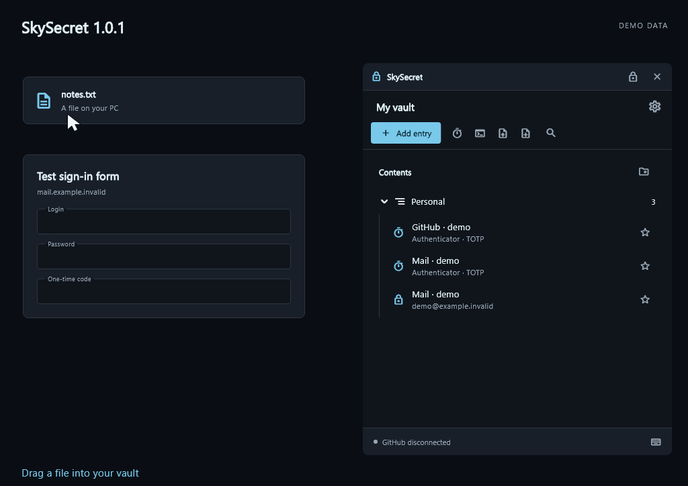
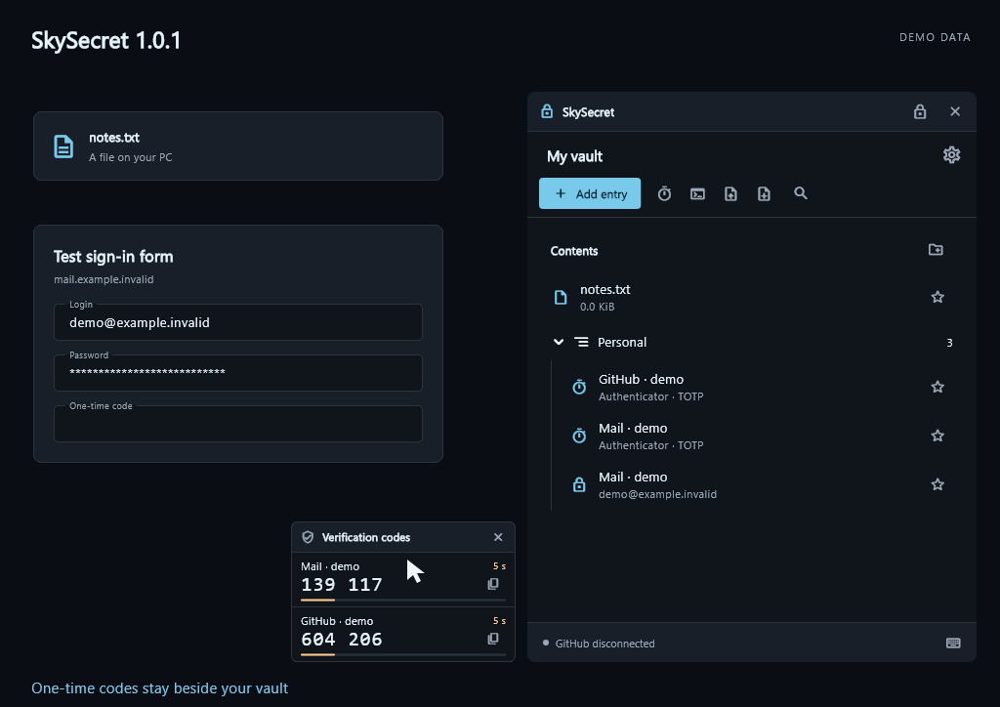
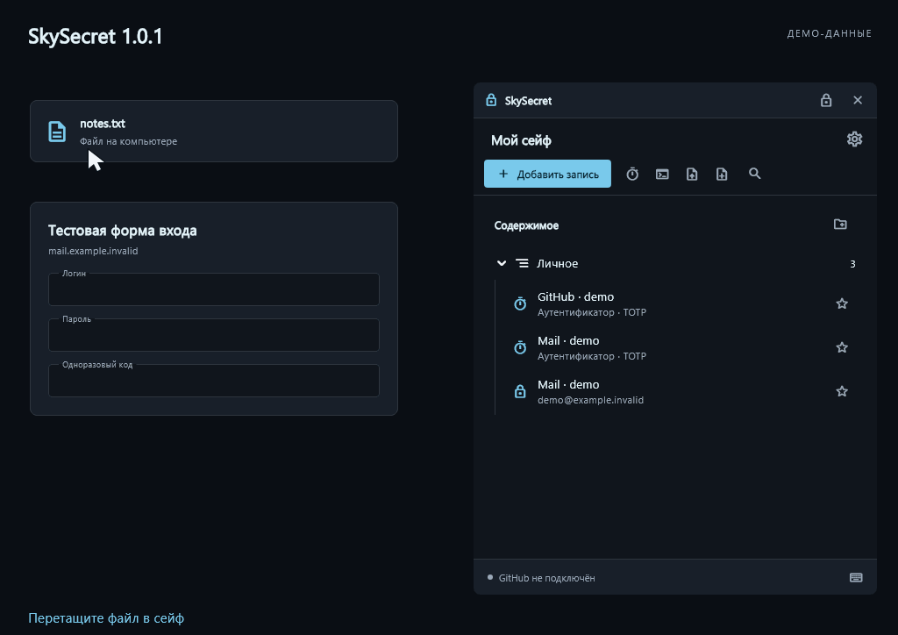
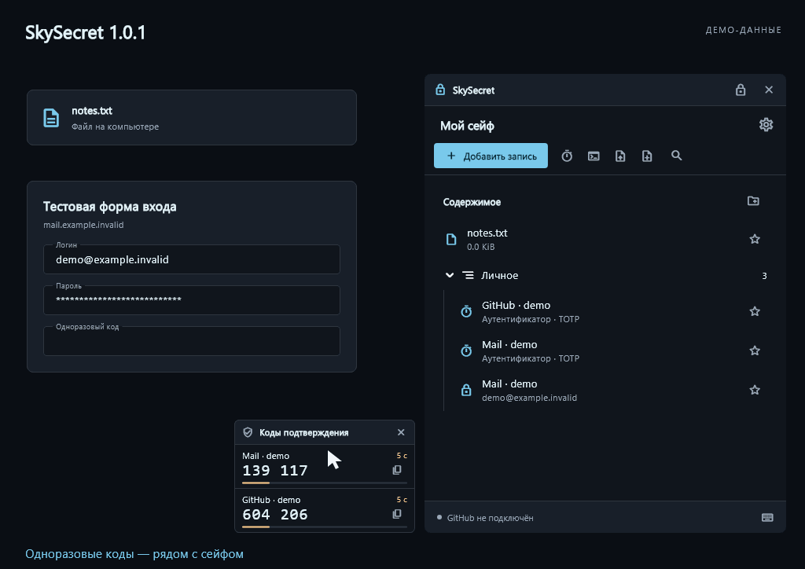

> **Enigma / VirusTotal — EN:** Some antivirus engines on VirusTotal flag `sky_secret_enigma.exe`. These detections alone do not prove that the file contains a virus. Enigma bundles SkySecret and its libraries into one EXE for convenience. Choose `sky_secret_portable.zip` for the version without Enigma.
>
> **Enigma / VirusTotal — RU:** Некоторые антивирусные движки на VirusTotal отмечают `sky_secret_enigma.exe`. Сами по себе эти срабатывания не доказывают наличие вируса в файле. Enigma объединяет SkySecret и библиотеки в один EXE для удобства. Вариант без Enigma — `sky_secret_portable.zip`.

# SkySecret

[English](#english) · [Русский](#русский) · [Downloads](https://github.com/Skyonave/sky_secret/releases/latest)

## English

SkySecret stores passwords, notes, files, SSH connections and TOTP codes in encrypted vaults on your PC. It runs in the Windows tray and opens with **Shift+Space**. The app works offline; a GitHub account is optional.

### Features

- **Vaults, folders and favorites.** Keep several vaults, arrange entries in folders and pin the ones you use often.
- **Drag to fill.** Drag an account to a compatible sign-in form. SkySecret fills the login and password when it can identify the pair. For a single field, it uses the login in a normal field and the password in a masked field. It does not use the clipboard or press Sign in. **Esc** cancels the drag.
- **TOTP codes.** Codes appear in a separate panel beside the vault, with a countdown until the next code. Click a code to copy it. Add an authenticator using its setup key or an `otpauth://` URI.
- **Files in and out.** Drag a file into the vault to store it. Drag it onto the desktop or File Explorer to export a copy. Exported files are not encrypted.
- **Search in place.** **F** opens a search bar that filters the main list. Found entries keep their usual actions, including drag to fill. Clear or close search to restore the list.
- **Password generator and text editor.** Generate passwords or English passphrases inside an entry. Create `.txt` files and edit them in a separate window.
- **SSH connections.** Save connection details and open a session through Windows OpenSSH.
- **Backups and sync.** Export and import encrypted `.smv` files, use local history, or connect GitHub for backups and manual sync with conflict review.

### Demos

Import a file, then drag an account into a sign-in form:

Watch a TOTP code change, copy it and paste it into the form:

The GIFs use demo data and a local test sign-in form.

### Platforms

| Platform | Supported | CLI | Executable |
| --- | :---: | :---: | :---: |
| Windows x64 | ✅ | ❌ | ✅ `.exe` |
| Linux | ❌ | ❌ | ❌ |
| macOS | ❌ | ❌ | ❌ |
| Android | ❌ | ❌ | ❌ |
| iOS | ❌ | ❌ | ❌ |

The current release is a portable Windows x64 app. There is no CLI.

### Getting started

1. Open the [release page](https://github.com/Skyonave/sky_secret/releases/latest). For `sky_secret_portable.zip`, extract the whole archive and run `SkySecret.exe` from that folder. The single-file `sky_secret_enigma.exe` runs directly.
2. Press **Shift+Space** or use the tray icon. Create a vault and choose a master password. **There is no master-password reset.**
3. Add entries with the buttons above the list or the right-click menu. When the vault is locked, opening the manager puts the cursor in the password field.
4. To start the app with Windows, enable **Start when signing in to Windows** in vault settings and save. After moving the EXE, enable it again from the new location.

### Your data

Save edits before hiding the app: hiding locks the vault by default. Copied values are cleared from the clipboard after **10 seconds**; a manual, idle or Windows lock clears the app's current copy immediately.

Keep verified, independent copies of your vaults. We work to protect your data, but cannot guarantee its security or recovery. [Protection and limits](SECURITY.md).

## Русский

SkySecret хранит пароли, заметки, файлы, SSH-подключения и TOTP-коды в зашифрованных сейфах на компьютере. Приложение работает в трее Windows и открывается по **Shift+Space**. Интернет для работы не нужен; GitHub подключается по желанию.

### Возможности

- **Сейфы, папки и избранное.** Можно завести несколько сейфов, разложить записи по папкам и закрепить часто используемые.
- **Заполнение перетаскиванием.** Перетащите запись в совместимую форму входа. Если SkySecret распознаёт пару полей, он заполняет логин и пароль. В отдельное обычное поле попадёт логин, в скрытое — пароль. Буфер обмена не используется, кнопка входа не нажимается. **Esc** отменяет перетаскивание.
- **TOTP-коды.** Коды открываются отдельной панелью рядом с сейфом. У каждого виден срок действия; нажатие копирует код. Аутентификатор добавляется по ключу настройки или ссылке `otpauth://`.
- **Перетаскивание файлов.** Перетащите файл в сейф, чтобы сохранить его. Перетащите обратно на рабочий стол или в Проводник, чтобы получить копию. Экспортированные файлы не зашифрованы.
- **Поиск в списке.** **F** открывает строку поиска и фильтрует основной список. У найденных записей доступны обычные действия, включая перетаскивание в поля ввода. Очистка или закрытие поиска возвращает список.
- **Генератор и текстовый редактор.** Генерируйте пароли или английские парольные фразы прямо в записи. Создавайте `.txt`-файлы и редактируйте их в отдельном окне.
- **SSH-подключения.** Сохраняйте параметры подключения и открывайте сеанс через Windows OpenSSH.
- **Копии и синхронизация.** Экспортируйте и импортируйте зашифрованные `.smv`-файлы, используйте локальную историю или подключите GitHub для резервных копий и ручной синхронизации с разбором конфликтов.

### Демонстрации

Добавление файла в сейф и заполнение формы перетаскиванием записи:

Смена TOTP-кода, копирование и вставка в форму:

В GIF используются демо-данные и локальная тестовая форма входа.

### Платформы

| Платформа | Поддержка | CLI | Исполняемый файл |
| --- | :---: | :---: | :---: |
| Windows x64 | ✅ | ❌ | ✅ `.exe` |
| Linux | ❌ | ❌ | ❌ |
| macOS | ❌ | ❌ | ❌ |
| Android | ❌ | ❌ | ❌ |
| iOS | ❌ | ❌ | ❌ |

Текущий выпуск — переносимое приложение для Windows x64. CLI нет.

### Начало работы

1. Откройте [страницу выпуска](https://github.com/Skyonave/sky_secret/releases/latest). Если выбрали `sky_secret_portable.zip`, распакуйте архив целиком и запустите `SkySecret.exe` из этой папки. Однофайловый `sky_secret_enigma.exe` запускается сразу.
2. Нажмите **Shift+Space** или откройте приложение из трея. Создайте сейф и задайте мастер-пароль. **Сброса мастер-пароля нет.**
3. Добавляйте записи кнопками над списком или через меню по правой кнопке мыши. Если сейф закрыт, при открытии менеджера курсор сразу попадёт в поле пароля.
4. Для автозапуска включите **Запускать при входе в Windows** в настройках сейфов и сохраните. После перемещения EXE включите настройку заново из нового расположения.

### Ваши данные

Сохраняйте правки перед скрытием приложения: по умолчанию оно блокирует сейф. Скопированные значения удаляются из буфера через **10 секунд**; ручная блокировка, тайм-аут и блокировка Windows сразу очищают текущую копию приложения.

Храните проверенные независимые копии сейфов. Мы максимально стараемся обезопасить данные, но не можем гарантировать их безопасность и восстановление. [Защита и её границы](SECURITY.md).

---

Passphrase wordlist / словарь парольных фраз: [EFF Long Wordlist](https://www.eff.org/dice), Joseph Bonneau / Electronic Frontier Foundation, [CC BY 4.0](https://creativecommons.org/licenses/by/4.0/). [Attribution / источник](assets/wordlists/NOTICE.txt) · [License](LICENSE)
